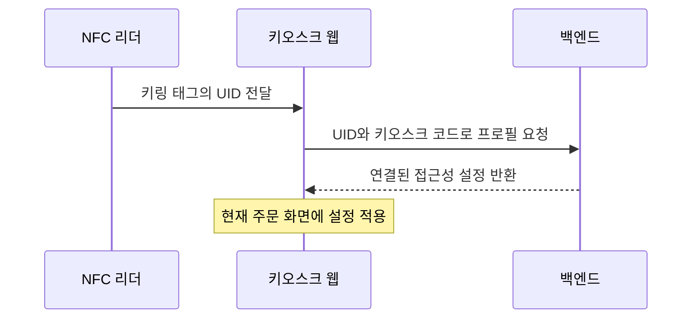

# MODI 키오스크 프런트엔드

> 2026 4호선톤 · NFC 키링으로 내게 맞는 키오스크 화면 불러오기

작은 메뉴 글씨를 읽거나, 높은 곳의 주문 버튼에 손을 뻗거나, 작은 수량 버튼을 정확히 누르는 일은 사용자마다 어렵게 느끼는 지점이 다릅니다. MODI는 모바일 웹에서 필요한 접근성 옵션을 미리 저장하고 NFC 키링에 연결해, 주문할 때마다 키오스크에서 설정을 찾는 수고를 줄입니다.

이 저장소는 카페 키오스크의 **메뉴 선택부터 주문 완료까지의 화면**과 **태그로 불러온 접근성 프로필의 적용**을 담당합니다. 결제와 진동벨은 화면 시연으로 구현했습니다.

## 같은 주문 흐름에 접근성 적용하기

큰 글씨를 켜거나 주문 버튼을 아래로 옮겨도 사용자가 이미 담은 상품과 현재 주문 단계는 이어져야 합니다. 옵션별로 주문 화면을 따로 관리하면 장바구니나 상품 옵션 처리도 여러 화면에서 맞춰야 합니다. MODI는 하나의 주문 흐름을 유지하면서 **주문 상태와 접근성 프로필을 분리**했습니다.

[`Kiosk`](src/pages/kiosk/Kiosk.jsx)가 현재 단계, 선택 상품, 장바구니를 관리하고, 상품 옵션과 주문 확인·결제 화면에는 담기·수량 변경·화면 이동에 필요한 동작을 전달합니다. 프로필은 별도 상태로 관리합니다. NFC 태그로 프로필을 받으면 같은 화면에서 스타일, 렌더링 조건, 입력 보조 동작만 갱신합니다. 시작 화면으로 돌아가면 장바구니와 프로필을 함께 초기화합니다.

### 필요한 변화에 따라 적용 방식 나누기

| 접근성 옵션 | 사용자에게 보이는 변화 | 구현 방식과 이유 |
| --- | --- | --- |
| **고대비** | 글씨와 주요 버튼, 선택된 항목을 배경에서 구별하기 쉬워집니다. | 배경·본문·동작·선택 상태에 지정한 색을 CSS 변수로 적용합니다. 화면마다 색을 따로 정하는 반복을 줄이고, 기존 디자인의 팔레트를 유지하면서 대표 색상 조합의 대비율을 검증합니다. |
| **큰 글씨** | 상품명과 주요 조작부가 커집니다. | 글씨와 카드 배치를 함께 바꾸고 메뉴를 더 적은 상품 단위로 나눕니다. 기존 상품 수를 그대로 표시하면 커진 글씨와 버튼이 쓸 공간이 부족해지기 때문입니다. |
| **화면 하단 조작** | 장바구니 항목을 취소하거나 주문을 진행하는 주요 조작부에 아래쪽에서 접근할 수 있습니다. | 메뉴에서는 상품 탐색과 하단 장바구니 조작을 함께 배치하고, 상품 옵션과 결제 화면도 해당 단계에 필요한 조작을 아래로 배치합니다. 단계마다 필요한 버튼과 순서가 달라 화면별 렌더링도 조정합니다. |
| **터치 위치 안내** | 상품을 담거나 주문을 진행할 때 다음에 누를 버튼 근처에 안내가 나타납니다. | 각 화면에서 대상 버튼과 문구를 지정하고, 공통 로직이 현재 화면에 나타난 대상을 찾아 표시합니다. 주문 단계의 맥락은 해당 화면에서 정하고, 대상을 찾는 동작은 여러 화면에서 공유합니다. |
| **터치 입력 보정** | 수량 버튼처럼 작은 조작부를 살짝 빗나간 터치를 보완합니다. | 버튼 근처의 짧은 터치를 범위 안에서 가장 가까운 활성 버튼의 클릭으로 연결합니다. 그 버튼의 기존 동작을 그대로 호출하며, 버튼을 직접 누른 입력과 이동 거리가 큰 입력은 보정에서 제외합니다. |

이 구조에서 대비율 계산, 버튼 탐색, 안내 대상 추적은 공통 모듈이 맡습니다. 팔레트·보정 범위·안내 위치는 키오스크 화면의 설정과 스타일에 둡니다. 주문 흐름을 공유하면서도 화면별로 필요한 조작 방식은 조정할 수 있습니다. [접근성 모듈화 PR](https://github.com/MODI-LINE4THONE/MODI-KIOSK-FE/pull/35)

### 옵션을 함께 켰을 때

- **큰 글씨 + 하단 조작**은 확대된 카드와 하단 버튼이 제한된 높이를 나눠 써야 합니다. 메뉴에 전용 배치를 두어 페이지당 상품 수를 더 줄이고, 선택 상품의 미리보기와 수량 조작을 제공합니다. 시작·메뉴 화면에서는 확대 배치를 쓰고 이후 주문 단계에서는 하단 배치를 우선합니다.
- **고대비 + 터치 안내**는 말풍선에도 같은 고대비 테마의 색상 값을 적용합니다. 하단 조작으로 버튼의 배치가 바뀌는 화면에서는 말풍선 위치도 함께 조정합니다.
- **터치 안내 + 입력 보정**에서 말풍선 본체는 터치 입력을 가로채지 않습니다. 안내는 다음 버튼을 보여 주고, 보정은 현재 화면에 렌더링된 버튼의 위치를 기준으로 입력을 처리합니다.

## NFC 태그에서 화면 변경까지



키오스크는 리더의 키보드 입력을 읽고, 성공한 **HTTP 응답**을 다섯 옵션의 상태로 변환합니다. 요청이 실패하면 기존 설정을 유지한 채 안내를 표시합니다.

## 기술 스택 및 실행

React 19 · JavaScript · Vite 8 · styled-components

**온라인 체험**은 [배포된 키오스크](https://modi-kiosk-test.netlify.app/)에서 매장 또는 포장을 선택한 뒤 상품 담기부터 주문 완료까지 진행할 수 있습니다. 접근성 옵션을 직접 켜고 비교하려면 아래 로컬 미리보기를 사용하세요. 최신 `develop`의 설정 패널은 개발 서버에서 열립니다.

**로컬 실행**에는 Node.js 20.19 이상(20.x) 또는 22.12 이상이 필요합니다. 저장소의 `develop` 브랜치에서 실행합니다.

```bash
npm ci
npm run dev
```

- [접근성 미리보기](http://localhost:5173/?preview)에서 **접근성 프로필 테스트**를 열면 키링과 백엔드 없이 다섯 옵션을 개별 또는 조합으로 적용해 볼 수 있습니다. 큰 글씨와 하단 조작을 함께 켜고 메뉴를 골라 단계별 배치를 확인해 보세요. 터치 위치 안내는 상품 옵션 화면에서, 터치 보정은 장바구니의 수량 버튼 가장자리 바깥을 짧게 눌러 확인할 수 있습니다.
- 실물 태그 시연에는 키보드 입력 방식의 NFC 리더, 프로필에 연결된 키링, 서버에 등록된 `KIOSK-001`이 필요합니다. 로컬 API 주소를 바꾸려면 `.env.example`을 `.env.local`로 복사해 `VITE_API_BASE_URL`을 설정합니다.
- `npm test`로 색상 대비율 계산과 대표 팔레트를 검증하고, `npm run build`로 배포용 파일을 생성합니다.

[모바일 웹](https://github.com/MODI-LINE4THONE/MODI-MOBILE-FE) · 접근성 프로필 설정과 키링 등록

[백엔드](https://github.com/MODI-LINE4THONE/MODI-BE) · 프로필 저장과 NFC 태그 조회
